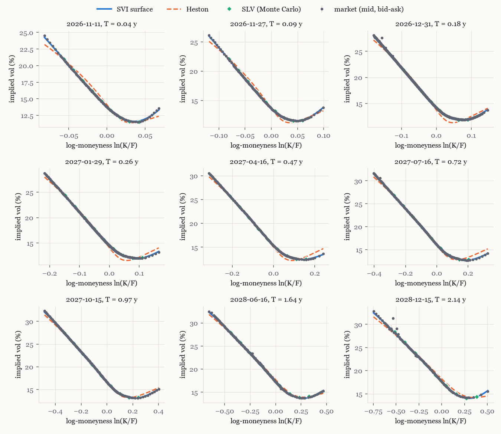

# option-pricing-lab

Option pricing library in Python: European, American, Asian and barrier options under Black-Scholes,
Heston, Dupire local volatility and a Heston stochastic-local-volatility (SLV) model whose leverage
function is calibrated by the particle method. Calibrated on an SPX option snapshot and on a simulated
market, with a test suite that checks every pricer against an independent reference.

**Demo**: [luca-cs.github.io/option-pricing-lab](https://luca-cs.github.io/option-pricing-lab/): a pricing desk
in the browser (price and Greeks, animated Monte Carlo under Black-Scholes or the SPX-calibrated Heston model,
exercise boundary, value and Greeks across spot), a guide to which model suits which product, and the SPX
model-risk results of the Python library.

## Results

**SPX, snapshot of 27 October 2026**: 9 maturities from two weeks to two years, 1,694 out-of-the-money
quotes. Errors in basis points of implied vol (1 bp = 0.01 vol point); median half bid-ask 2 to 7 bp.

| | 2 weeks | 1 month | 2 months | 3 months | 6 months | 9 months | 1 year | 1.6 years | 2.1 years |
|---|---|---|---|---|---|---|---|---|---|
| SVI surface vs quotes (RMSE) | 6.4 | 4.3 | 8.8 | 4.9 | 6.5 | 10.0 | 9.0 | 9.9 | 30.8 |
| Heston vs quotes (RMSE) | 51 | 51 | 50 | 46 | 44 | 37 | 26 | 33 | 59 |
| Local vol, Monte Carlo vs surface | 7.3 | 4.3 | 2.0 | 3.7 | 5.9 | 5.1 | 1.0 | 0.5 | 5.0 |
| SLV, Monte Carlo vs surface | 9.8 | 9.4 | 3.7 | 5.4 | 2.0 | 4.8 | 1.7 | 5.1 | 6.0 |

The Monte Carlo rows are mean absolute errors over 9 strikes with 300,000 paths (standard error 3 to 4 bp).
The surface is free of butterfly arbitrage and of calendar arbitrage on the checked band.

**Model risk.** Four models that agree on vanillas disagree on path-dependent payoffs (1 year, % of spot):

| | Black-Scholes (ATM vol) | Heston | Local vol | SLV (mix 0.5) |
|---|---|---|---|---|
| Down-and-out call, K 100 %, H 80 % | 8.63 | 8.76 | 8.79 | 8.83 |
| Up-and-out call, K 100 %, H 120 % | 1.87 | 4.69 | 3.49 | 3.97 |
| Down-and-in put, K 100 %, H 85 % | 3.65 | 4.84 | 4.72 | 4.76 |
| American put, K 100 % | 5.11 | 5.47 | 5.37 | 5.44 |

The up-and-out call doubles between Black-Scholes and the smile models, and moves by a third between local
vol and Heston: in the SLV it goes from 3.48 (mix 0, local vol) to 4.13 (mix 0.75) with the vanillas held
fixed.

**Simulated market** (quotes from a known Heston model plus 15 bp of noise): the calibration finds
v0 0.0250 (true 0.0250), kappa 1.801 (1.8), theta 0.0398 (0.04), xi 0.748 (0.75), rho -0.751 (-0.75).



Full tables and charts: [`reports/calibration.md`](reports/calibration.md).

**Tests**: 76, covering put-call parity (closed forms, Fourier, Monte Carlo), Monte Carlo convergence
(1/sqrt(N) error, closed forms within 4 standard errors), American >= European and the American call
without dividend equal to the European, the geometric Asian against its closed form, barriers against
Reiner-Rubinstein with the Broadie-Glasserman-Kou correction, parameter recovery for SSVI, SVI and
Heston, the vanillas reproduced by Dupire local vol and by the SLV model, and the JavaScript of the
demo page against the Python library (to 1e-9 on the closed forms).

## Method

### Products and pricers

| Product | Pricer | Reference it is tested against |
|---|---|---|
| European | closed form (Black-Scholes, Black), Fourier for Heston (Lewis formula, "little trap" characteristic function), Monte Carlo for every model | put-call parity, closed forms |
| American | Longstaff-Schwartz: cubic polynomial basis in S/K (plus v, v^2, S v under stochastic volatility), regression on in-the-money paths, exercise rule estimated on one set of paths and applied to an independent one (no foresight bias) | CRR binomial tree (2,000 steps, averaged over n and n + 1) |
| Asian, arithmetic | Monte Carlo with the geometric Asian as control variate (optimal coefficient) | discrete geometric Asian in closed form |
| Barrier (single, knock-in or out) | Monte Carlo with daily monitoring | Reiner-Rubinstein closed form with the Broadie-Glasserman-Kou continuity correction |

All Monte Carlo pricers use antithetic variates and report a standard error that accounts for the
pairing.

### Models

Every model is simulated in the log-forward coordinate x = ln(S_t / F(t)), with deterministic
discount and forward curves (`Market`). The log-Euler step with the instantaneous variance taken at
the start of the step keeps exp(x) an exact martingale, so forwards are matched by construction.
The time grid is graded (step dt_min + t / 60): a steep short-dated skew makes the first weeks the main
source of discretisation error, and a uniform 1/400 grid left 10 to 20 bp of bias at three months.

- **Black-Scholes**: exact one-step simulation.
- **Heston**: full-truncation Euler for the variance; semi-closed-form vanillas for calibration.
- **Dupire local volatility**: local variance from the total implied variance w(k, T) of the fitted surface,
  with every derivative analytic.
- **Heston SLV**: dS / S = ... + L(t, S) sqrt(v) dW, with the Heston variance whose vol of vol is scaled by a
  mixing fraction. The leverage solves L^2(t, x) E[v_t | x_t = x] = sigma_loc^2(t, x); the particle method of
  Guyon and Henry-Labordère estimates the conditional expectation by kernel regression on the simulated
  particles themselves, step by step. Particles are binned before the Gaussian kernel, so a step costs
  O(N + bins x grid) instead of O(N x grid).

### Calibration in three steps

1. **Implied surface.** An extended SSVI surface (Gatheral-Jacquier slices with their own skew and
   correlation, Hendriks-Martini) is fitted first: its parametrisation keeps it free of static arbitrage.
   A single SSVI slice has only three parameters and cannot follow the SPX smile (it leaves the deep put
   wing about 70 bp too low), so each maturity is then refitted as a raw SVI slice by the quasi-explicit
   method (Zeliade; De Marco and Martini): for fixed (m, sigma) the problem is a small quadratic programme
   whose constraints are linear (|rho| <= 1, Lee's wing bound, the slice above the previous one on a grid).
   Butterflies (Gatheral's g(k) > 0) are penalised in the outer search. Between maturities the total
   variance is interpolated linearly in the ATM total variance, which keeps ordered slices ordered.
2. **Heston** on the same quotes: least squares on vega-scaled price errors (first-order implied-vol
   errors), weighted by the inverse bid-ask width.
3. **SLV leverage** by particles, so that the SLV model reprices the vanillas of the surface.

The report is in [`reports/calibration.md`](reports/calibration.md).

## Data

SPX option quotes come from Yahoo Finance through `yfinance`. Yahoo's data are for personal use, so the
raw snapshot stays in `data/raw/` (ignored by git) and is never published: the repository and the demo only
contain calibrated parameters, curves rescaled to a spot of 100, model outputs and charts.

Cleaning, maturity by maturity: SPXW contracts (PM-settled) or the monthly AM-settled SPX contracts when
there is no SPXW expiry; two-sided quotes with a relative spread below 50 %; discount factor and forward
from put-call parity on near-the-money strikes, with a zero-rate curve smoothed over the maturities beyond
two months; out-of-the-money mid prices inverted to Black vols, within -3 to +2.5 ATM standard deviations.

The simulated market (quotes generated by a known Heston model plus noise) needs no download and checks
that the calibration finds the parameters back.

## Running

```bash
python -m venv .venv
.venv/Scripts/pip install -r requirements.txt     # .venv/bin/pip on Linux and macOS
python -m pytest                                  # about ten minutes, most of it in the SLV tests
python scripts/run_calibration.py --source simulated
python scripts/download_spx.py                    # personal-use snapshot in data/raw/
python scripts/run_calibration.py --source spx
python scripts/make_report.py
```

```python
from optlab import Market, HestonParams, HestonModel, barrier_mc

market = Market.flat(100.0, r=0.04, q=0.01)
model = HestonModel(HestonParams(v0=0.04, kappa=1.5, theta=0.04, xi=0.5, rho=-0.7))
price, stderr = barrier_mc(model, market, K=100, H=80, T=1.0, kind="down-out", cp="call")
```

`docs/` is the demo page (GitHub Pages): dependency-free JavaScript (`docs/lab.js`) for the closed forms, the
tree, Lévy's Asian approximation, Monte Carlo and Longstaff-Schwartz, checked against the Python library by
`tests/test_widget_js.py` (needs node), plus the SPX results written by `scripts/build_widget_data.py`. Deep
links open a given product: `?product=american&type=put&model=heston`. The full library, with live SLV recalibration, also has a
Gradio app that runs locally: `pip install gradio`, then `python space/app.py`.

## Layout

| Path | Content |
|---|---|
| `optlab/market.py` | discount and forward curves |
| `optlab/blackscholes.py` | closed forms, Greeks, implied vol, geometric Asian, barriers |
| `optlab/tree.py` | CRR binomial tree |
| `optlab/heston.py` | characteristic function, Lewis pricing, calibration |
| `optlab/ssvi.py`, `optlab/svi.py` | implied surfaces, arbitrage checks, Dupire local variance |
| `optlab/models.py` | path simulation for the four models |
| `optlab/products.py` | Monte Carlo pricers, Longstaff-Schwartz |
| `optlab/slv.py` | leverage function by the particle method |
| `optlab/data.py` | SPX chain download and cleaning |
| `optlab/pipeline.py`, `scripts/` | calibration runs, report and charts |
| `docs/` | demo page (GitHub Pages) |
| `space/` | Gradio app, run locally |
| `tests/` | pytest suite |

## Limitations

- **One snapshot, mid prices.** The SPX calibration uses a single intraday snapshot of delayed Yahoo
  quotes; the index level and the option quotes are not synchronous, which is why the spot is implied from
  the parity forwards. Bid-ask spreads are only used as weights.
- **Surface.** The calendar condition is enforced on a grid and checked on log-moneyness from -1 to 0.5
  (about -63 % to +65 % of the forward), not on the whole real line. The longest maturity (December 2028)
  is fitted at about 30 bp, against about 5 to 10 bp for the others: its quotes are wide and few.
- **Heston** cannot produce the steep short-dated SPX skew: about 50 bp of RMSE below six months, 25 to
  35 bp beyond. That is a property of the model, and the reason for the local and SLV models. The fitted
  parameters violate the Feller condition, as is usual on equity indices.
- **Discretisation.** Euler schemes (full truncation for the variance) rather than Andersen's QE scheme;
  the graded grid keeps the bias below the Monte Carlo noise in the tests, not at zero. Barriers are priced
  with daily monitoring only; the continuous case is reached through the Broadie-Glasserman-Kou shift.
- **SLV.** The leverage reprices the surface within a few basis points from three months on, and about
  10 bp at two to four weeks, where the local volatility is steepest; more particles and a finer grid
  would reduce it at a linear cost. The mixing fraction is a choice, not a calibration: fixing it would need
  quotes on barriers or forward-start options, which free data do not provide.
- **Rates and dividends** are deterministic, and dividends enter as a continuous yield implied from the
  forwards (no discrete dividends).
- **Performance.** Pure NumPy, single-threaded: a full SPX calibration with its validation runs in
  tens of minutes, most of it in the Monte Carlo checks.

## License

[MIT](LICENSE)
