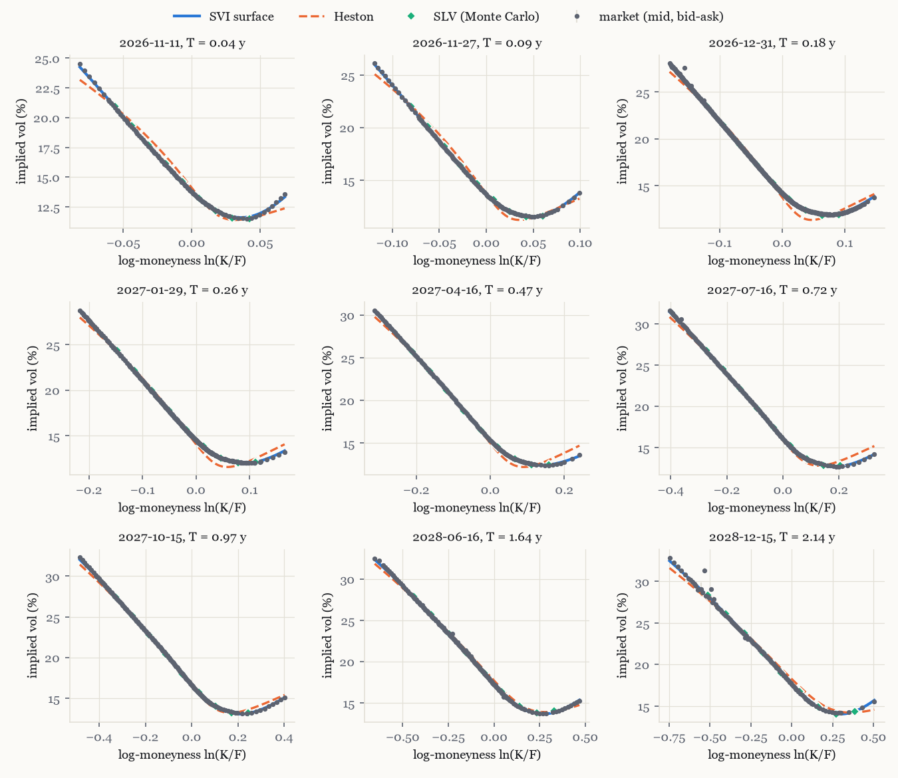

# option-pricing-lab

Option pricing library in Python: European, American, Asian and barrier options under Black-Scholes,
Heston, Dupire local volatility and a Heston stochastic-local-volatility (SLV) model whose leverage
function is calibrated by the particle method. Calibrated on an SPX option snapshot and on a simulated
market, with a test suite that checks every pricer against an independent reference.

**Demo**: [luca-cs.github.io/option-pricing-lab](https://luca-cs.github.io/option-pricing-lab/): a pricing desk
in the browser (price and Greeks, animated Monte Carlo under Black-Scholes or the SPX-calibrated Heston model,
exercise boundary, value and Greeks across spot), a guide to which model suits which product, and the SPX
model-risk results of the Python library.

## Results

**SPX, snapshot of 27 October 2026**: 9 maturities from two weeks to two years, 1,694 out-of-the-money
quotes. Errors in basis points of implied vol (1 bp = 0.01 vol point); median half bid-ask 2 to 7 bp.

| | 2 weeks | 1 month | 2 months | 3 months | 6 months | 9 months | 1 year | 1.6 years | 2.1 years |
|---|---|---|---|---|---|---|---|---|---|
| SVI surface vs quotes (RMSE) | 6.4 | 4.3 | 8.8 | 4.9 | 6.5 | 10.0 | 9.0 | 9.9 | 30.8 |
| Heston vs quotes (RMSE) | 51 | 51 | 50 | 46 | 44 | 37 | 26 | 33 | 59 |
| Local vol, Monte Carlo vs surface | 7.3 | 4.3 | 2.0 | 3.7 | 5.9 | 5.1 | 1.0 | 0.5 | 5.0 |
| SLV, Monte Carlo vs surface | 9.8 | 9.4 | 3.7 | 5.4 | 2.0 | 4.8 | 1.7 | 5.1 | 6.0 |

The Monte Carlo rows are mean absolute errors over 9 strikes with 300,000 paths (standard error 3 to 4 bp).
The surface is free of butterfly arbitrage and of calendar arbitrage on the checked band.

**Model risk.** Four models that agree on vanillas disagree on path-dependent payoffs (1 year, % of spot):

| | Black-Scholes (ATM vol) | Heston | Local vol | SLV (mix 0.5) |
|---|---|---|---|---|
| Down-and-out call, K 100 %, H 80 % | 8.63 | 8.76 | 8.79 | 8.83 |
| Up-and-out call, K 100 %, H 120 % | 1.87 | 4.69 | 3.49 | 3.97 |
| Down-and-in put, K 100 %, H 85 % | 3.65 | 4.84 | 4.72 | 4.76 |
| American put, K 100 % | 5.11 | 5.47 | 5.37 | 5.44 |

The up-and-out call doubles between Black-Scholes and the smile models, and moves by a third between local
vol and Heston: in the SLV it goes from 3.48 (mix 0, local vol) to 4.13 (mix 0.75) with the vanillas held
fixed.

**Simulated market** (quotes from a known Heston model plus 15 bp of noise): the calibration finds
v0 0.0250 (true 0.0250), kappa 1.801 (1.8), theta 0.0398 (0.04), xi 0.748 (0.75), rho -0.751 (-0.75).



Full tables and charts: [`reports/calibration.md`](reports/calibration.md).

**Tests**: 792, covering put-call parity (closed forms, Fourier, Monte Carlo), Monte Carlo convergence
(1/sqrt(N) error, closed forms within 4 standard errors), American >= European and the American call
without dividend equal to the European, the geometric Asian against its closed form, barriers against
Reiner-Rubinstein with the Broadie-Glasserman-Kou correction, parameter recovery for SSVI, SVI and
Heston, the vanillas reproduced by Dupire local vol and by the SLV model, the JavaScript of the
demo page against the Python library (to 1e-9 on the closed forms), and the CUDA engine called from Python
against the same references (skipped without a GPU). For the structured products: the script parser and its
errors, the calendar, the scripts against the library pricers bit for bit, every product family against a
closed form or a quadrature, the coupon solver, the Greeks, books, funded swaps, worst-of baskets and running
products.

## GPU Monte Carlo

[`cuda/`](cuda/README.md) is a C++/CUDA Monte Carlo engine for Black-Scholes and Heston (Andersen's QE scheme):
European, Asian and daily barrier options, validated against closed forms, Fourier and the Python library
within 4 standard errors. On an RTX 2070 Super, a Heston down-and-out call with 10^7 paths × 252 daily steps
takes 91 ms, 165 times faster than the same code in double-precision C++ on 12 CPU threads. Float paths agree
with double to 0.006 standard errors. The engine comes with a measured optimisation study (FP64, fast-math
intrinsics rejected for a 0.13 SE bias, Kahan float sums, stored against fused paths) and a Nsight Compute
profile: it found warps half idle in the QE step, and the fix cut the Heston kernel time by 31 %. From Python,
`optlab.gpu` calls the engine through `ctypes` and falls back to the NumPy pricers without a GPU.

The same directory holds the **path engine of the library** (`optlab.native`): every model (Black-Scholes, local
vol, Heston, SLV, correlated baskets with a local correlation) simulated with the library's discretisation on every
CPU thread or on the GPU, and the SLV leverage by the particle method. The structured products and the desk use it
with `engine="auto"`; NumPy stays the default of the library and the reference of the tests. At one million paths:

| | NumPy, 1 core | NumPy, 6 workers | CPU engine | GPU engine |
|---|---|---|---|---|
| Phoenix 2 years, local vol | 31.9 s | 11.5 s | 2.8 s | 0.19 s |
| Worst-of Phoenix on 3 names | 104.5 s | 34.8 s | 6.4 s | 0.29 s |
| BRC 1 year, daily barrier | 23.2 s | 6.2 s | 1.8 s | 0.08 s |
| SLV leverage, 1 year, 200,000 particles | 4.5 s | | 1.3 s | 0.16 s |

Prices agree with NumPy within the Monte Carlo error; the machine, the method and the next steps are in
[cuda/ROADMAP.md](cuda/ROADMAP.md). Without an NVIDIA card the engine builds for the CPU alone
(`-DOPTLAB_WITH_CUDA=OFF`), and without a compiler everything stays on NumPy.

## Structured products

[`optlab/structured/`](optlab/structured) prices equity structured products (autocalls Athena and Phoenix,
reverse convertibles and barrier reverse convertibles, airbags, capital-protected notes) as a note or as a swap,
on top of a small payoff scripting language:

- **Script language.** A hand-written recursive-descent parser turns a text script (`underlying`, `param`,
  `event DATE pay DATE ... end`, `if/else`, `pay ... as coupon|upside|redemption`, `terminate`, `lowest` and
  `highest` windows over business days) into an AST; visitors validate it (errors carry the line and column),
  list the dates to simulate, classify the product and evaluate it on paths with float masks. On the same
  paths the scripts reproduce `european_mc` and `barrier_mc` bit for bit under the four models.
- **Term-sheet builder.** A declarative schema of sections (General, Wrapper, Autocall, Coupon, Upside,
  Downside) where a product mask (`autocall` or `bullet`) exposes the relevant sections and fields that
  depend on other choices appear only when they apply; a compiler turns the term sheet into the script, the
  readable representation of the product. Calendar: Monday to Friday, modified following, T+5 payments,
  ACT/365F.
- **Pricing policy.** The model follows the product: a payoff that depends on the final fixing only is
  replicated on the SVI smile (one-dimensional integral against the implied density, exact on linear pieces,
  refined around strikes and barriers, no Monte Carlo noise); path-dependent and autocallable products go to
  SLV Monte Carlo, with local vol as a model-risk control. By default the coupon is solved for a target price
  (note at 100 - margin, swap at zero upfront); the upfront mode prices a given coupon.

Validation under Black-Scholes, within 4 standard errors of independent references: closed forms for reverse
convertibles, geared puts, airbags, digitals and call spreads (replication to 1e-8); Broadie-Glasserman-Kou
for the daily knock-in (97.3591 ± 0.0182 against 97.3615); a backward quadrature on a log-spot grid with
memory and knock-in states for the autocalls (Phoenix with memory 101.5366 ± 0.0161 against 101.5487).

**Autocall model risk** (Phoenix 2 years, quarterly, autocall 100 %, coupon barrier 70 %, European knock-in
60 %, no memory, note at 98 %, 200,000 paths):

| | Black-Scholes (ATM vol) | Local vol | Heston | SLV |
|---|---|---|---|---|
| Coupon solved (% p.a.) | 2.90 ± 0.02 | 6.07 ± 0.06 | 4.22 ± 0.05 | 5.12 ± 0.05 |
| Price at the SLV coupon (%) | 99.48 | 97.58 | 98.41 | 98.00 |
| Called at the first date | 52.6 % | 65.3 % | 68.9 % | 65.6 % |
| Expected life (years) | 0.72 | 0.53 | 0.53 | 0.54 |

```python
from optlab.structured import preset, quote

q = quote(preset("phoenix", **{"coupon.barrier": 0.65}), with_greeks=True)   # SPX calibration by default
print(q.table())                  # policy and reason, coupon solved ± SE, control model, flows by date
print(q.script)                   # the generated script, with the solved coupon
```

Beyond single products:

- **Book.** `Book([Position(...), ...])` prices positions (term sheets, scripts or solved quotes, long or short) on
  one shared simulation over the union of their dates, so the book error accounts for the correlation between
  positions (a reverse convertible plus the put it is short is a bond, with zero error), and bumps that
  simulation for book Greeks; with a basket context it mixes single names and worst-ofs, with a delta and a vega
  per underlying.
- **Funded swap.** A swap can carry a floating funding leg (single curve, ACT/360, plus a spread) that stops at
  the autocall; without spread or payment lag it equals the note minus par path by path.
- **Worst-of.** Up to five correlated underlyings, each on its own model and forward curve (`worst(...)` in the
  scripts, `general.basket = "worst_of"` in the term sheet), validated against the bivariate normal for the
  worst-of digital and a conditional one-dimensional integral for the worst-of put. Only SPX is calibrated
  here, so other names, their volatility and the correlation are inputs.
- **Running products.** Past fixings (`fixings={"SPX": {date: level}}`) for products already struck; flows paid
  before the valuation date drop out, knock-ins and calls that already happened are taken into account, and
  `events()` lists what happened (coupons paid or missed, call, knock-in date, maturity). Fixings far from the
  model's spot (real index levels against the market rescaled to 100) are refused until converted.
- **Trades and market data.** `Trade` stores a term sheet or a script with its quantity and strike date as JSON
  (`TermSheet.to_dict`/`from_dict`, `json_schema()` for a front end); `optlab.marketdata` gives every calibrated
  market an id hashed on its content (`MarketSnapshot`, an immutable local `MarketStore` under `data/store`), and
  quotes and books carry it. A NYSE calendar (`general.calendar = "nyse"`) drives schedules and daily windows.
- **Speed.** Measured on a Phoenix 2 years: a bit-identical fast path of the SVI surface makes local vol about twice
  as fast (2.15 times with a European knock-in, 1.92 daily); `workers=6` runs the batches on a process pool (4.7
  times faster at 10^6 SLV paths, same numbers bit for bit); Greeks bump the spot on the base paths (local vol
  Greeks from 45 to 14 s at 100,000 paths). Opt-in, within the Monte Carlo error: forward control variates
  (`control_forwards`, variance divided by 1.3 to 2.2), grid-interpolated models (`fast=True`, local vol 2.7 to 3.6
  times and SLV 1.6 to 1.8 times faster) and randomised quasi-Monte Carlo (`price_rqmc`, Sobol with a Brownian
  bridge: variance divided by 24 to 29 under Black-Scholes and local vol, by 2.7 under SLV).

`python scripts/structured_examples.py` prints the model-risk table, timings, example quotes, worst-of coupons
against the correlation and a book (about five minutes at 200,000 paths).

## Desk

`python -m optlab.app --open` starts a local web desk over the library at `http://localhost:8765`, with nothing to
install beyond the requirements: a standard-library HTTP server, SQLite, and plain JavaScript modules with no build
step and no CDN.

- **Pricer**: presets or a blank autocall or bullet, a term-sheet form generated from the schema (levels and rates
  typed in percent, errors under the field), a quote run as a background job with progress and cancel. The result
  shows the solved coupon or the price with its standard error, the model the policy chose and why, the gap to the
  control model in standard errors, the probability of ending at each date, the expected flows, and on request the
  delta and vega (sticky moneyness, sticky strike or the model's own; SLV vega by recalibrating the leverage) and
  the SLV mix band. Quick precision (20,000 paths) prices a 2-year Phoenix under SLV in about 2 s, Standard
  (100,000) in 6 s; SLV vega adds about 15 s.
- **Worst-ofs**: up to five names. Only SPX is calibrated, so the others are flat Black-Scholes markets whose
  volatility, dividend, rate and correlations are set on the Market screen; the policy prices them with local vol
  per name (a 2-year SPX/SX5E Phoenix at Quick precision: 5.6 s, delta and vega per name).
- **Book**: trades kept in SQLite with their versions, edit, delete with undo. The book is valued in two groups,
  each on one shared simulation: single names under the policy (SLV for autocalls) and worst-ofs under the basket
  context; the groups are independent, so their errors add in quadrature. Risk comes as delta and vega per
  underlying.
- **Trade page**: the term sheet, the value at today's market (price, value, delta, vega), the events, every
  version, the quote it came from, and "quote a copy" to restart from it in the pricer.
- **Lifecycle**: fixings pasted as `date level` lines or imported from a CSV (the Close column of a Yahoo export),
  real index levels converted with the real spot; per trade, what happened (coupons paid or missed, call, knock-in)
  and the next observations.
- **Market**: the snapshots in the local store (every calibration file is registered, immutable and identified by
  its content) and the switch between them, the SVI smiles, the ATM term structure, forwards and discount factors,
  the model-risk table and the calibration fit. **Script lab**: any single-name payoff of the script language,
  checked as it is typed, priced under any model.

- **Risk** (`#/risk`): the Greeks of the live book per trade, per underlying and in total, each with its standard error (delta
  sticky moneyness, sticky strike and realistic, gamma at 1 and 5 %, vega per tenor and per node with net, gross and weighted,
  vanna, volga, skew vega, theta split into carry, events and decay, rho and epsilon per tenor, correlation and cross gamma), the
  vega matrix, the spot ladder under three vol rules, the hypothetical scenarios (signed and versioned, edited on the screen),
  and the historical VaR by full revaluation with its stressed window and contributions. **P&L explained** (`#/pnl`): stored
  end-of-day runs, daily and cumulated, the cascade of full revaluations (time, spot, vol, skew, rates, dividends, correlation,
  FX) against the prediction of the Greeks, per trade, with events and new trades. Method and measured numbers in
  [reports/risk.md](reports/risk.md); `scripts/risk_eod.py` runs the same from the console.

Every table sorts by its headers. Sharing while the engine stays on this PC:

| How | Start with | Notes |
|---|---|---|
| Your network | `python -m optlab.app --host 0.0.0.0` | prints an address with a generated token (kept in a cookie after the first visit); on Windows the firewall must let Python in, which needs the connection in the Private profile: the desk checks this at start and says what blocks other machines |
| A public link | `python -m optlab.app --tunnel` | https through an SSH tunnel to localhost.run: no install (`ssh` ships with Windows 10 and later), the address changes at each start; a third party relays the traffic, so the token is always on |
| A fixed result | Desk snapshot (Overview), or the report of a quote or of the book | one standalone HTML file that opens anywhere without the desk: the market in use, the book with its risk by underlying, the trades, the next observations and the recent quotes; send the file or publish it as a page |

The page is served by the desk itself, not by GitHub Pages, because browsers block a public https page from calling
a server on a private address. Trades, fixings, quotes, settings and market snapshots live under `data/store/`,
which git ignores.

## Method

### Products and pricers

| Product | Pricer | Reference it is tested against |
|---|---|---|
| European | closed form (Black-Scholes, Black), Fourier for Heston (Lewis formula, "little trap" characteristic function), Monte Carlo for every model | put-call parity, closed forms |
| American | Longstaff-Schwartz: cubic polynomial basis in S/K (plus v, v^2, S v under stochastic volatility), regression on in-the-money paths, exercise rule estimated on one set of paths and applied to an independent one (no foresight bias) | CRR binomial tree (2,000 steps, averaged over n and n + 1) |
| Asian, arithmetic | Monte Carlo with the geometric Asian as control variate (optimal coefficient) | discrete geometric Asian in closed form |
| Barrier (single, knock-in or out) | Monte Carlo with daily monitoring | Reiner-Rubinstein closed form with the Broadie-Glasserman-Kou continuity correction |

All Monte Carlo pricers use antithetic variates and report a standard error that accounts for the
pairing.

### Models

Every model is simulated in the log-forward coordinate x = ln(S_t / F(t)), with deterministic
discount and forward curves (`Market`). The log-Euler step with the instantaneous variance taken at
the start of the step keeps exp(x) an exact martingale, so forwards are matched by construction.
The time grid is graded (step dt_min + t / 60): a steep short-dated skew makes the first weeks the main
source of discretisation error, and a uniform 1/400 grid left 10 to 20 bp of bias at three months.

- **Black-Scholes**: exact one-step simulation.
- **Heston**: full-truncation Euler for the variance; semi-closed-form vanillas for calibration.
- **Dupire local volatility**: local variance from the total implied variance w(k, T) of the fitted surface,
  with every derivative analytic.
- **Heston SLV**: dS / S = ... + L(t, S) sqrt(v) dW, with the Heston variance whose vol of vol is scaled by a
  mixing fraction. The leverage solves L^2(t, x) E[v_t | x_t = x] = sigma_loc^2(t, x); the particle method of
  Guyon and Henry-Labordère estimates the conditional expectation by kernel regression on the simulated
  particles themselves, step by step. Particles are binned before the Gaussian kernel, so a step costs
  O(N + bins x grid) instead of O(N x grid).

### Calibration in three steps

1. **Implied surface.** An extended SSVI surface (Gatheral-Jacquier slices with their own skew and
   correlation, Hendriks-Martini) is fitted first: its parametrisation keeps it free of static arbitrage.
   A single SSVI slice has only three parameters and cannot follow the SPX smile (it leaves the deep put
   wing about 70 bp too low), so each maturity is then refitted as a raw SVI slice by the quasi-explicit
   method (Zeliade; De Marco and Martini): for fixed (m, sigma) the problem is a small quadratic programme
   whose constraints are linear (|rho| <= 1, Lee's wing bound, the slice above the previous one on a grid).
   Butterflies (Gatheral's g(k) > 0) are penalised in the outer search. Between maturities the total
   variance is interpolated linearly in the ATM total variance, which keeps ordered slices ordered.
2. **Heston** on the same quotes: least squares on vega-scaled price errors (first-order implied-vol
   errors), weighted by the inverse bid-ask width.
3. **SLV leverage** by particles, so that the SLV model reprices the vanillas of the surface.

The report is in [`reports/calibration.md`](reports/calibration.md).

## Data

SPX option quotes come from Yahoo Finance through `yfinance`. Yahoo's data are for personal use, so the
raw snapshot stays in `data/raw/` (ignored by git) and is never published: the repository and the demo only
contain calibrated parameters, curves rescaled to a spot of 100, model outputs and charts.

Cleaning, maturity by maturity: SPXW contracts (PM-settled) or the monthly AM-settled SPX contracts when
there is no SPXW expiry; two-sided quotes with a relative spread below 50 %; discount factor and forward
from put-call parity on near-the-money strikes, with a zero-rate curve smoothed over the maturities beyond
two months; out-of-the-money mid prices inverted to Black vols, within -3 to +2.5 ATM standard deviations.

The simulated market (quotes generated by a known Heston model plus noise) needs no download and checks
that the calibration finds the parameters back.

### The historical lake

`optlab/marketdata/` keeps ten years of free data in Parquet files read by DuckDB: index and share prices, dividends and
splits (Yahoo), volatility, skew and correlation indices (Cboe, STOXX), Treasury, AAA and overnight rates (US Treasury, ECB, FRED),
and option chains (a free 2022 sample with SPX maturities up to five years, DoltHub for two-month chains). It lives outside the
repository: only parameters and statistics are versioned, and the data stays local.

Every row says what it is: `observed`, `derived`, `reconstructed` or `synthetic`, and the desk shows it. Loads are idempotent and
keep past versions. `pit.market_at(lake, "SPX", "2020-03-23")` returns the market of that date from rows dated up to it; the
anti-look-ahead test erases the future and checks that no past price changes.

No free source gives long surface history after 2023. Surfaces are therefore rebuilt from volatility indices and an assumed smile
shape, and tested against real chains: [reports/surface_reconstruction.md](reports/surface_reconstruction.md) gives the error by
moneyness and maturity (0.7 to 0.9 volatility point near the money beyond six months, 1 to 2 in the wings, with a biased
wing). [reports/replay.md](reports/replay.md) follows a BRC and a Phoenix through their lives on the real closes.

## Running

```bash
python -m venv .venv
.venv/Scripts/pip install -r requirements.txt     # .venv/bin/pip on Linux and macOS
python -m pytest                                  # about ten minutes, most of it in the SLV tests
python scripts/run_calibration.py --source simulated
python scripts/download_spx.py                    # personal-use snapshot in data/raw/
python scripts/run_calibration.py --source spx
python scripts/make_report.py
```

```python
from optlab import Market, HestonParams, HestonModel, barrier_mc

market = Market.flat(100.0, r=0.04, q=0.01)
model = HestonModel(HestonParams(v0=0.04, kappa=1.5, theta=0.04, xi=0.5, rho=-0.7))
price, stderr = barrier_mc(model, market, K=100, H=80, T=1.0, kind="down-out", cp="call")
```

`docs/` is the demo page (GitHub Pages): dependency-free JavaScript (`docs/lab.js`) for the closed forms, an
American PDE (Crank-Nicolson with projected SOR on a strike-centred grid, so that the Greeks are smooth in the
spot), the tree, Lévy's Asian approximation, Heston by Fourier, Monte Carlo (Andersen's QE scheme for Heston)
and Longstaff-Schwartz, checked against the Python library by `tests/test_widget_js.py` (needs node), plus the
SPX results written by `scripts/build_widget_data.py`. Deep links open a given case, for instance
`?product=barrier&K=119&model=heston`. The full library, with live SLV recalibration, also has a Gradio app that
runs locally: `pip install gradio`, then `python space/app.py`.

## Layout

| Path | Content |
|---|---|
| `optlab/market.py` | discount and forward curves |
| `optlab/blackscholes.py` | closed forms, Greeks, implied vol, geometric Asian, barriers |
| `optlab/tree.py` | CRR binomial tree |
| `optlab/heston.py` | characteristic function, Lewis pricing, calibration |
| `optlab/ssvi.py`, `optlab/svi.py` | implied surfaces, arbitrage checks, Dupire local variance |
| `optlab/models.py` | path simulation for the four models |
| `optlab/products.py` | Monte Carlo pricers, Longstaff-Schwartz |
| `optlab/slv.py` | leverage function by the particle method |
| `optlab/gpu.py` | Python bridge to the CUDA engine, NumPy fallback |
| `optlab/data.py` | SPX chain download and cleaning |
| `optlab/structured/` | structured products: script language, term-sheet builder, policy, pricers |
| `optlab/risk/` | risk engine: shocks and one revaluation engine, Greeks, ladder, scenarios, VaR, EOD runs and explained P&L |
| `optlab/app/` | local web desk: HTTP server, JSON API, jobs, SQLite store, reports, the page in `static/` |
| `optlab/pipeline.py`, `scripts/` | calibration runs, report and charts |
| `cuda/` | C++/CUDA Monte Carlo engine, benchmarks and optimisation study |
| `docs/` | demo page (GitHub Pages) |
| `space/` | Gradio app, run locally |
| `tests/` | pytest suite |

## Limitations

- **One snapshot, mid prices.** The SPX calibration uses a single intraday snapshot of delayed Yahoo
  quotes; the index level and the option quotes are not synchronous, which is why the spot is implied from
  the parity forwards. Bid-ask spreads are only used as weights.
- **Surface.** The calendar condition is enforced on a grid and checked on log-moneyness from -1 to 0.5
  (about -63 % to +65 % of the forward), not on the whole real line. The longest maturity (December 2028)
  is fitted at about 30 bp, against about 5 to 10 bp for the others: its quotes are wide and few.
- **Heston** cannot produce the steep short-dated SPX skew: about 50 bp of RMSE below six months, 25 to
  35 bp beyond. That is a property of the model, and the reason for the local and SLV models. The fitted
  parameters violate the Feller condition, as is usual on equity indices.
- **Discretisation.** The Python library uses Euler schemes (full truncation for the variance) rather than
  Andersen's QE scheme; the graded grid keeps the price bias below the Monte Carlo noise in the tests, not at
  zero. The paths themselves are another matter: with the SPX parameters (Feller ratio 0.19) the truncated
  variance sits at or below zero on about 30 % of the steps, so Heston paths go flat for days. The demo page
  uses the QE scheme, which removes this; porting it to the library (where the SLV step needs it too) is
  the next step. Barriers are priced
  with daily monitoring only; the continuous case is reached through the Broadie-Glasserman-Kou shift.
- **SLV.** The leverage reprices the surface within a few basis points from three months on, and about
  10 bp at two to four weeks, where the local volatility is steepest; more particles and a finer grid
  would reduce it at a linear cost. The mixing fraction is a choice, not a calibration: fixing it would need
  quotes on barriers or forward-start options, which free data do not provide.
- **Rates and dividends** are deterministic, and dividends enter as a continuous yield implied from the
  forwards (no discrete dividends).
- **Structured products.** Deterministic rates, no holidays in the calendar, worst-of baskets under local vol
  or Black-Scholes only (no SLV across names, no correlation skew),
  maturities up to the last calibrated one (2.14 years; beyond, the surface is extrapolated and the SLV
  leverage is not fitted, and the pricer says so). Vega is a parallel shift of the implied vols; under SLV it
  recalibrates the leverage on each shifted surface (`slv_vega=True`, a few seconds per calibration), which on a
  European payoff gives back the smile vega (-0.3136 ± 0.0055 against -0.3106 by replication).
- **Performance.** Pure NumPy, single-threaded: a full SPX calibration with its validation runs in
  tens of minutes, most of it in the Monte Carlo checks.

## License

[MIT](LICENSE)
