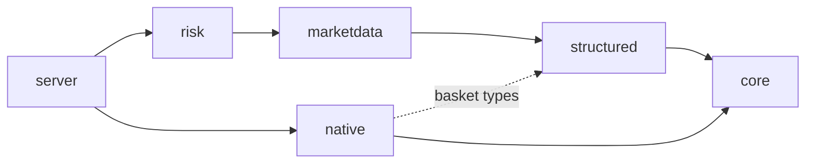
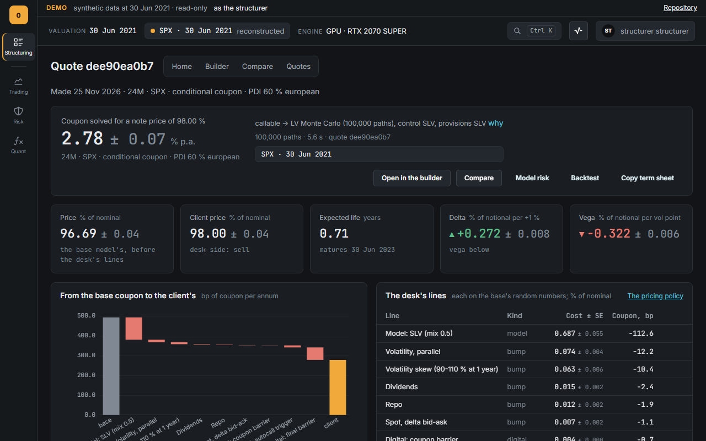
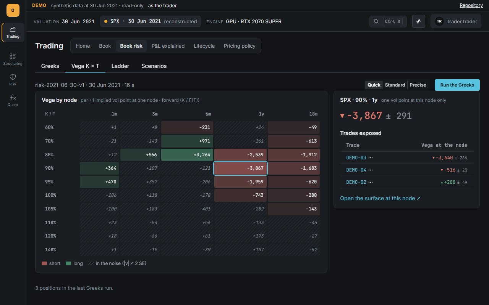
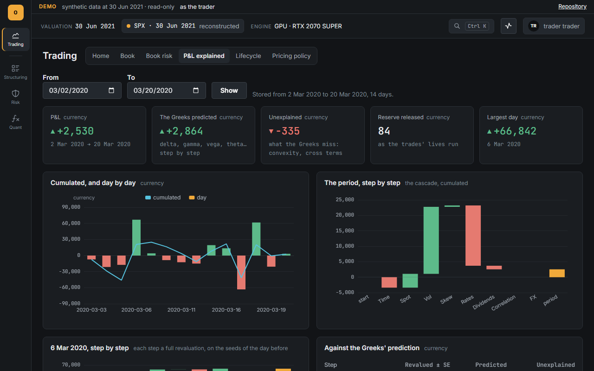
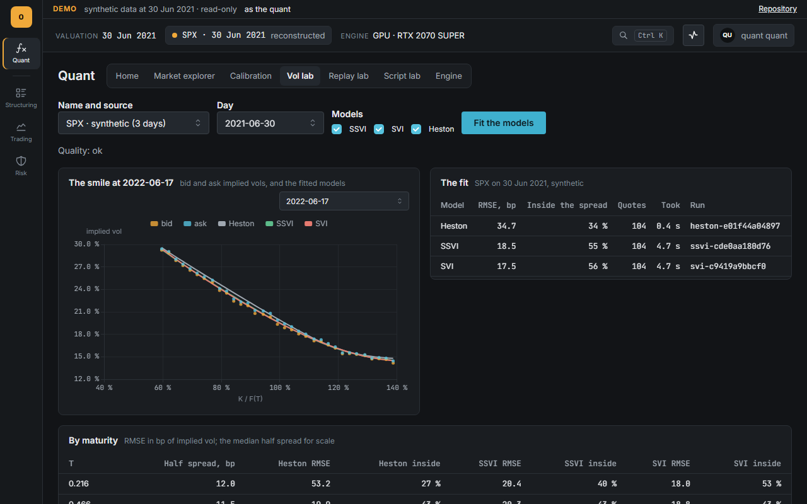
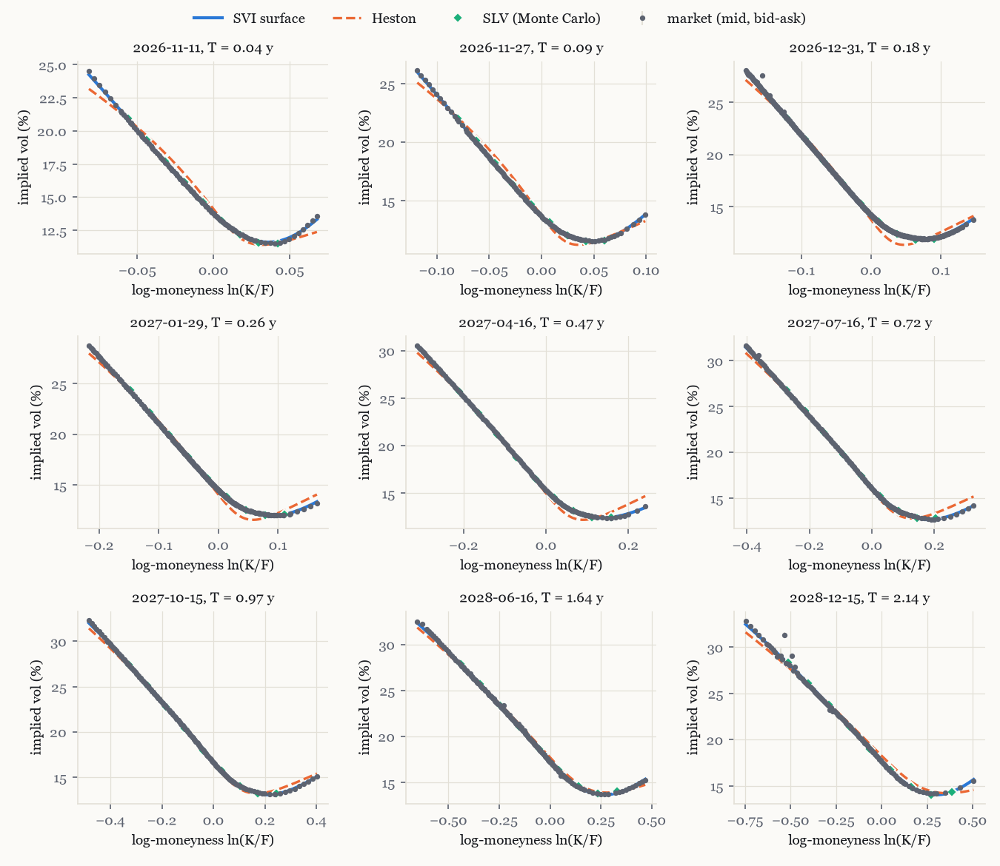

# option-pricing-lab

An equity derivatives lab in Python, C++ and CUDA:

- **Models** calibrated on real SPX quotes: an arbitrage-free SVI surface, Heston, Dupire local vol, and a stochastic-local-vol
  model whose leverage is fitted by the particle method.
- **Structured products**: autocalls (asynchronous calls on a worst-of, lizards), reverse convertibles, worst-ofs, and the
  light exotics: variance and volatility swaps and their corridors, accumulators and decumulators, outright or fully
  funded. Products are written in a payoff script language of its own or built from a term sheet. The desk price is a
  base plus explicit model reserves, overs and digital overhedges.
- **A risk engine**: Greeks with their standard errors (a shifted vega among them), ladders, scenarios, a historical VaR
  by full revaluation, and the explained P&L, its vol move opened node by node and by delta bucket under each spot-vol
  rule.
- **A market-data lake**: ten years built from free sources, where every row says whether it was observed, derived or
  reconstructed.
- **A GPU Monte Carlo engine**: the same paths on every CPU thread or on the card.
- **A desk**: an API with accounts, roles, an audit log and background jobs, and a web front for the structurer, the
  trader, risk, the quant and the admin.

Every stochastic number is checked against an independent reference, within four standard errors.

**Demo**: [luca-cs.github.io/option-pricing-lab](https://luca-cs.github.io/option-pricing-lab/), the desk's front on a
session recorded on made-up data, with a guided story for each of three profiles: the structurer, the trader and the quant.
The [pricing lab](https://luca-cs.github.io/option-pricing-lab/lab/) computes in the browser: prices and Greeks, animated
Monte Carlo under Black-Scholes or the SPX-calibrated Heston model, the American exercise boundary, and the model-risk
results below.

The documentation goes from this overview down to each part: [docs/README.md](docs/README.md).

## What is in it

| Package | What it does |
|---|---|
| [`optlab.core`](packages/core/src/optlab/core) | Curves, closed forms and implied vol, the CRR tree, Heston by Fourier, SSVI and SVI surfaces with the Dupire local variance, path simulation, the Monte Carlo pricers (European, Asian with a control variate, daily barriers, Longstaff-Schwartz), the SLV leverage by particles, the calibration chain. NumPy and SciPy only. |
| [`optlab.native`](packages/native) | The C++/CUDA engine, bound to Python with nanobind: fixed products under Black-Scholes and Heston (Andersen's QE), and the path engine that runs every model of the library on every CPU thread or on the GPU. |
| [`optlab.structured`](packages/structured/src/optlab/structured) | A payoff script language with a hand-written parser, a term-sheet builder driven by schema and masks, the pricing policy (replication on the smile for a European payoff, local vol Monte Carlo otherwise, with SLV as control and model reserve), the coupon solver, books, worst-ofs with local correlation, the desk price. |
| [`optlab.marketdata`](packages/marketdata/src/optlab/marketdata) | The lake: append-only Parquet read by DuckDB, idempotent and bitemporal loads, one cleaning chain for every option source, point-in-time markets, surfaces rebuilt from volatility indices, replays of trades on real closes. |
| [`optlab.risk`](packages/risk/src/optlab/risk) | One revaluation engine for every risk: shocks on spots, vols, curves, dividends, correlations and FX, revalued on the base's random numbers. Greeks, ladders, scenarios, VaR and the P&L cascade come from it. |
| [`optlab.server`](packages/server/src/optlab/server) | The desk's API v1 (FastAPI): accounts and roles, sessions with CSRF, an audit log, a persistent job queue with a worker, one SQLite database, reports, and the `optlab` command line. |



The layers are checked by `lint-imports` ([ADR-0004](docs/architecture/adr/0004-dependency-direction.md)): no package
imports one above it, and only the server imports the compiled engine. The others ask for an engine by name. The
architecture is in [docs/architecture](docs/architecture/README.md), and each package's internals in
[library.md](docs/architecture/library.md).

## The desk

The desk is a local API over the library ([docs/architecture/api.md](docs/architecture/api.md)). Its web front
(`frontend/`, [docs/ux.md](docs/ux.md)) is one application on that API, in five spaces: Structuring, Trading, Risk,
Quant and Admin. The public demo replays a session recorded on it. The captures below come from the demo, on made-up
data.

| | |
|---|---|
|  |  |
| A quote: the coupon solved on the client price, the model the policy chose, the desk's lines | The book's vega by node (K × T), down to the trades behind a node |
|  |  |
| The explained P&L: each day revalued step by step, against what the Greeks predicted | The vol lab: SSVI, SVI and Heston fitted to a chain, with their error against the spread |

- **Builder**: a term-sheet form generated from the schema, and a quote run as a background job with its progress. The
  result gives:
  - the solved coupon or the price, with its standard error;
  - the pricing model: the product's class, the base model the policy chose and why, the control model and its gap, the
    model reserves;
  - the probability of ending at each date and the expected flows;
  - on request, delta and vega under three smile dynamics.
- **Desk price** ([reports/pricing.md](reports/pricing.md)): a local vol base, then:
  - model reserves for the models that go against the desk (SLV, local correlation);
  - overs on the market inputs, signed by the trader: overvol, overskew, overcorrel, overdiv, overrepo, the delta
    bid-ask;
  - digital overhedges: each digital read as a call spread.

  Each line is computed on the base's random numbers, and the coupon is solved on the client price.
- **Book and lifecycle**: versioned trades, fixings pasted or imported, events (coupons, calls, knock-ins), reserves released
  over a trade's life.
- **Risk and P&L**: every measure of the risk engine, and end-of-day runs kept with what determines them.
- **Operations**: jobs that survive a restart, scheduled backups of the database and the lake with a checked restore, and
  containers in WSL2 with ports on 127.0.0.1 and read-only roots ([operations](docs/architecture/operations.md)).

## Getting started

The full guide, from a fresh machine to the desk in production: [docs/getting-started.md](docs/getting-started.md).
The short version:

```bash
uv sync --locked --all-extras                       # https://docs.astral.sh/uv/ ; builds the native engine (CUDA if found)
uv run pytest -n 6 --dist loadfile                  # 954 tests; without the lake, a GPU or node, those parts skip
uv run optlab --help                                # serve, worker, users, backup, calib, lake, risk, structured, bench
```

```python
from optlab.core.market import Market
from optlab.core.models import HestonModel
from optlab.core.heston import HestonParams
from optlab.core.products import barrier_mc

market = Market.flat(100.0, r=0.04, q=0.01)
model = HestonModel(HestonParams(v0=0.04, kappa=1.5, theta=0.04, xi=0.5, rho=-0.7))
price, stderr = barrier_mc(model, market, K=100, H=80, T=1.0, kind="down-out", cp="call")
```

```python
from optlab.structured import PricingContext, preset, quote

ctx = PricingContext.from_calibration("results/spx_calibration.json")
q = quote(preset("phoenix", **{"coupon.barrier": 0.65}), ctx, with_greeks=True)
print(q.table())                  # the policy and its reason, the coupon solved ± SE, the control model, the flows
print(q.script)                   # the generated script, with the solved coupon written in
```

The desk:

```bash
uv run optlab users create <name> --roles admin     # the password is asked twice
uv run optlab serve --workers 6                     # http://127.0.0.1:8765/api/v1 ; OPTLAB_DOCS=true adds /api/v1/docs
uv run optlab serve --demo-data                     # the same on made-up data
```

With the front built (`npm ci --ignore-scripts && npm run build` in `frontend/`), `OPTLAB_FRONTEND=frontend/dist` serves it
on the same origin. The desk listens on 127.0.0.1 only; the LAN profile is an explicit choice, and the desk is never
exposed to the internet ([ADR-0002](docs/architecture/adr/0002-never-exposed.md)). Running it in containers, backups
and releases: [operations.md](docs/architecture/operations.md).

## Results



**SPX, snapshot of 27 October 2026**: 9 maturities from two weeks to two years, 1,694 out-of-the-money quotes. Errors are in
basis points of implied vol (1 bp = 0.01 vol point). The median half bid-ask is 2 to 7 bp.

| | 2 weeks | 1 month | 2 months | 3 months | 6 months | 9 months | 1 year | 1.6 years | 2.1 years |
|---|---|---|---|---|---|---|---|---|---|
| SVI surface vs quotes (RMSE) | 6.4 | 4.3 | 8.8 | 4.9 | 6.5 | 10.0 | 9.0 | 9.9 | 30.8 |
| Heston vs quotes (RMSE) | 51 | 51 | 50 | 46 | 44 | 37 | 26 | 33 | 59 |
| Local vol, Monte Carlo vs surface | 7.3 | 4.3 | 2.0 | 3.7 | 5.9 | 5.1 | 1.0 | 0.5 | 5.0 |
| SLV, Monte Carlo vs surface | 9.8 | 9.4 | 3.7 | 5.4 | 2.0 | 4.8 | 1.7 | 5.1 | 6.0 |

The Monte Carlo rows are mean absolute errors over 9 strikes with 300,000 paths (standard error 3 to 4 bp). The surface is
free of butterfly arbitrage, and of calendar arbitrage on the band checked.

**Model risk.** Four models that agree on vanillas disagree on path-dependent payoffs (1 year, % of spot):

| | Black-Scholes (ATM vol) | Heston | Local vol | SLV (mix 0.5) |
|---|---|---|---|---|
| Down-and-out call, K 100 %, H 80 % | 8.63 | 8.76 | 8.79 | 8.83 |
| Up-and-out call, K 100 %, H 120 % | 1.87 | 4.69 | 3.49 | 3.97 |
| Down-and-in put, K 100 %, H 85 % | 3.65 | 4.84 | 4.72 | 4.76 |
| American put, K 100 % | 5.11 | 5.47 | 5.37 | 5.44 |

The up-and-out call more than doubles from Black-Scholes to the smile models, and Heston prices it a third above local vol.
In the SLV it goes from 3.48 (mix 0, local vol) to 4.13 (mix 0.75), with the vanillas held fixed.

**Autocall model risk.** A Phoenix of 2 years, quarterly: autocall at 100 %, coupon barrier 70 %, European knock-in
at 60 %, no memory, a note at 98 %, 200,000 paths.

| | Black-Scholes (ATM vol) | Local vol | Heston | SLV |
|---|---|---|---|---|
| Coupon solved (% p.a.) | 2.90 ± 0.02 | 6.07 ± 0.06 | 4.22 ± 0.05 | 5.08 ± 0.05 |
| Price at the SLV coupon (%) | 99.45 | 97.57 | 98.40 | 98.00 |
| Called at the first date | 52.6 % | 65.3 % | 68.9 % | 65.5 % |
| Expected life (years) | 0.72 | 0.53 | 0.53 | 0.54 |

The same product pays a coupon twice as high under local vol as under Black-Scholes. That is why the desk prices on a
smile model and keeps the gap to SLV as a model reserve when it goes against it ([reports/pricing.md](reports/pricing.md)).

**Risk of a book.** The showcase book has twelve structured trades dealt on past dates, valued on 4 November 2026 (amounts
in USD):

| | VaR 99 % | ES 97.5 % |
|---|---|---|
| 1 day, full revaluation | 573,576 (SE 3,275) | 643,073 |
| 10 days | 1,768,567 | 1,742,404 |
| Stressed window, 29/03/2019 to 07/04/2020 | 1,508,111 | 1,493,891 |

The explained P&L cascades full revaluations: time, spot, vol, skew, rates, dividends, correlation and FX. It is set against
the prediction of the Greeks, trade by trade ([reports/risk.md](reports/risk.md)).

**Engines.** The path engine simulates every model of the library on every CPU thread or on the GPU, with the
library's own discretisation and Philox normals. Prices therefore depend only on the seed and the number of paths. The
times below are the wall time of one quote of a million paths (`optlab bench accel`, RTX 2070 Super, 12 threads):

| | NumPy, 1 core | NumPy, 6 workers | CPU engine | GPU engine |
|---|---|---|---|---|
| Phoenix 2 years, local vol | 31.7 s | 12.4 s | 2.82 s | 0.34 s |
| Phoenix 2 years, SLV | 24.9 s | 5.99 s | 3.63 s | 0.39 s |
| BRC 1 year, daily barrier, local vol | 23.4 s | 7.53 s | 1.84 s | 0.32 s |
| Worst-of Phoenix on 3 names, local vol | 113.5 s | 36.6 s | 6.33 s | 0.54 s |
| SLV leverage, 1 year, 200,000 particles | 4.41 s | | 1.35 s | 0.15 s |

The GPU times are taken between NumPy runs, so the card has slowed its clock by then. Warmed up and run back to back,
the BRC takes 0.09 s and the SLV Phoenix 0.2 s.

NumPy and the engines draw different normals, so their prices differ within the standard error (99.0067 against
99.0137 ± 0.0120); the CPU and GPU engines agree to the last digit shown. NumPy stays the library's default and the
reference of its tests. For the fixed products of the CUDA study, a Heston down-and-out call with 10^7 paths and 252 daily
steps takes 91 ms on the card ([packages/native/cuda](packages/native/cuda/README.md)).

## How it is checked

- **954 tests**, each stochastic pricer against an independent reference within 4 standard errors. The references
  include:
  - put-call parity and the closed forms;
  - a CRR tree for the American;
  - Reiner-Rubinstein with the Broadie-Glasserman-Kou shift for daily barriers;
  - the bivariate normal for worst-of digitals;
  - a backward quadrature with memory and knock-in states for the autocalls;
  - the JavaScript of the pricing lab against the Python library, to 1e-9 on the closed forms.

  The risk engine is checked against closed forms (Greeks, ladders, scenarios), a bivariate integration (cross gamma)
  and a P&L cascade that adds up to 1e-9.
- **Golden numbers**: 14 groups of results, recorded once, are recomputed bit for bit after every change. They cover the
  closed forms, the Monte Carlo products, the calibration, the presets, the showcase's Greeks and VaR, and the engines. The
  GPU's reductions use atomics, so they are compared within a stated tolerance.
- **CI** on Windows and Linux, about four minutes per pull request:
  - ruff (bandit, bugbear, complexity at most 15) and pyright at zero errors (strict on the server's security core);
  - the import layers;
  - the API contract: the front compiles on the types generated from the OpenAPI document;
  - the front: lint, unit tests, and end-to-end tests with axe on every screen in both themes, against the API and
    against the public demo;
  - the images built and scanned with Trivy;
  - CodeQL, gitleaks over the history, pip-audit of the lock, and Dependabot.

## Data

SPX option quotes come from Yahoo Finance, whose data are for personal use. The raw snapshot stays in `data/raw/` (ignored by
git). The repository and the demo only hold calibrated parameters, curves rescaled to a spot of 100, model outputs and
charts.

The lake lives outside the repository. It holds:

- prices, dividends and splits from Yahoo;
- volatility, skew and correlation indices from Cboe and STOXX;
- rates from the US Treasury, the ECB, FRED, the Japanese Ministry of Finance, the Bank of Japan and the Bank of England;
- option chains: a free 2022 sample, and DoltHub.

No free source gives a long surface history after 2023, so surfaces are rebuilt from volatility indices and tested against
real chains ([reports/surface_reconstruction.md](reports/surface_reconstruction.md)): 0.7 to 0.9 vol point near the money
beyond six months, 1 to 2 in the wings. [reports/replay.md](reports/replay.md) follows a BRC and a Phoenix through their
lives on real closes.

## Documentation

| Read | For |
|---|---|
| [docs/README.md](docs/README.md) | The map of the documentation, from the overview down |
| [docs/architecture](docs/architecture/README.md) | How the system fits together: processes, packages, data, invariants |
| [docs/architecture/library.md](docs/architecture/library.md) | Each package's internals: simulation, products, desk price, market data, risk |
| [docs/ux.md](docs/ux.md) | The front: principles, spaces, bridges, design system, the public demo |
| [docs/architecture/api.md](docs/architecture/api.md) | The API's conventions |
| [docs/architecture/operations.md](docs/architecture/operations.md) | Running the desk: accounts, backups, containers, releases |
| [docs/architecture/security.md](docs/architecture/security.md) | How the desk protects the machine, its data and its users |
| [packages/native/cuda](packages/native/cuda/README.md) | The GPU engine, its optimisation study and its profile |

Results, each measured and reproducible by an `optlab` command:

| Report | What it measures |
|---|---|
| [calibration.md](reports/calibration.md) | The SPX and simulated calibrations, error tables and charts |
| [pricing.md](reports/pricing.md) | The desk price: base, model reserves, overs and digital overhedges, on examples |
| [risk.md](reports/risk.md) | The risk engine's method, its validation and the showcase's measures |
| [showcase.md](reports/showcase.md) | The desk on real history, in fifteen minutes |
| [replay.md](reports/replay.md) | Two products through their lives on real closes |
| [surface_reconstruction.md](reports/surface_reconstruction.md) | Surfaces rebuilt from indices against real chains |
| [fx_check.md](reports/fx_check.md) | FX in the lake and the size of the quanto adjustment |

## Limitations

- **One snapshot, mid prices.** The SPX calibration uses one intraday snapshot of delayed Yahoo quotes. The index level and
  the quotes are not synchronous, so the spot is implied from the parity forwards. Bid-ask spreads are only used as weights.
- **Surface.** The calendar condition is enforced on a grid and checked on log-moneyness from -1 to 0.5. The longest maturity
  is fitted at about 30 bp, against 5 to 10 bp for the others: its quotes are wide and few.
- **Heston** cannot produce the steep short-dated SPX skew (about 50 bp of RMSE below six months). That is why the local and
  SLV models are there.
- **Discretisation.** The library simulates Heston with full-truncation Euler on a graded grid. That keeps the price bias
  below the Monte Carlo noise in the tests, not at zero. The GPU engine's fixed products use Andersen's QE scheme.
- **SLV.** The leverage reprices the surface within a few basis points from three months on, and about 10 bp at two to four
  weeks. The mixing fraction is a choice, not a calibration: fixing it would need barrier or forward-start quotes, which free
  data do not provide.
- **Rates and dividends** are deterministic. Dividends enter as a continuous yield implied from the forwards (the SPX
  calibration) or as last year's flows repeated (the lake's markets).
- **Structured products** are priced up to the last calibrated maturity. Beyond it the surface is extrapolated, and the
  pricer says so. A name without a market in use is priced on the lake's market of the same date, or else on flat inputs.

  Those reconstructed surfaces carry the errors of
  [reports/surface_reconstruction.md](reports/surface_reconstruction.md).

## License

[MIT](LICENSE)
