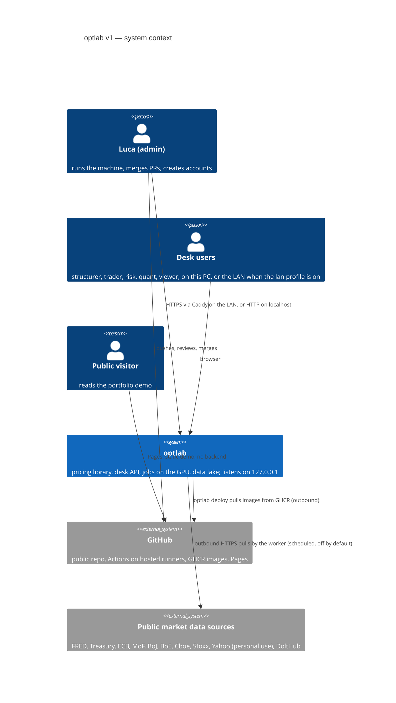
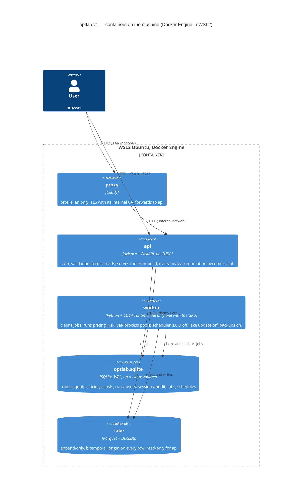
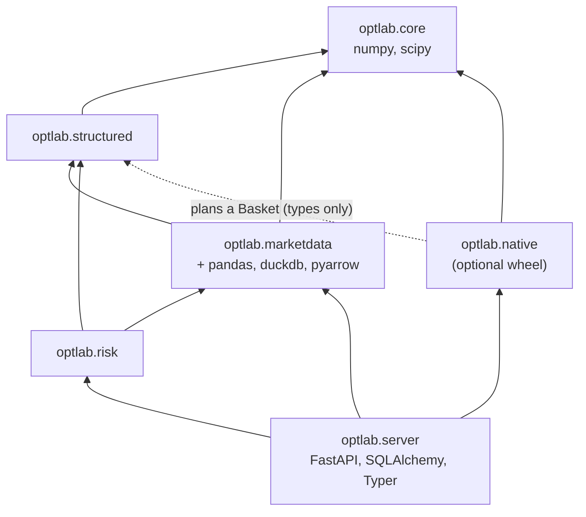

# optlab v1: target architecture

Status: **proposed** (A0, 7 November 2026), for Luca's review at the A0 checkpoint. Decisions are in `adr/`, the parity
list in `feature-inventory.md`, the threat model in `security.md`, the vocabulary in `glossary.md`.

optlab is an option pricing library (closed forms, Heston, local vol, SLV, structured products, a risk engine, a
historical data lake) with a desk on top. v1 keeps every number of v0 and changes how the code is cut, served, run,
tested and shipped. One machine runs it (Ryzen 5 3600, 24 GB, RTX 2070 Super, Windows 11 with WSL2), for a few named
users, and **it is never reachable from the internet**: the public face is a static demo on GitHub Pages.

## 1. Context



Nothing calls into the machine from outside: no port forwarding, no tunnel, no webhook. Every connection the machine
makes is outbound (market data, image pulls).

## 2. Containers (processes)



- **api** never computes anything long: a quote, a valuation, a VaR or a fit is a row in the `jobs` table. It answers
  `202 {job_id}`, and the page follows `GET /api/v1/jobs/{id}/events` (SSE).
- **worker** is the only process that sees the GPU. It claims jobs from the same SQLite file (atomic `UPDATE ...
  RETURNING`), writes progress to the row, checks the cancel flag cooperatively, and keeps the VaR's spawn process
  pool, to which it passes the engine explicitly (a spawned process does not inherit `native.set_default`).
- **proxy** exists only in the `lan` profile, off by default; turning it on needs Luca's agreement (firewall rule on the
  Private profile and the local subnet).
- Ports are published on `127.0.0.1:` only. The Docker daemon listens on its unix socket only, and no container mounts
  it. WSL stays in NAT mode.
- Native development on Windows stays possible: `optlab serve` and `optlab worker` run the same code without
  containers.

## 3. Packages (components)

A modular monolith: one repository, one `uv` workspace, several installable distributions sharing the PEP 420
namespace `optlab` (validated by a spike in A0, ADR-0003).

```
packages/
  core/        optlab.core        models, Market, simulate, pricers, calibration, instrument registry, engine registry
  native/      optlab.native      nanobind bindings + C++/CUDA sources (today's cuda/) -> one wheel; optional
  structured/  optlab.structured  script language, schema, compiler, policy, quote, costs, portfolio
  marketdata/  optlab.marketdata  lake, sources, derive, pit, replay, vollab
  risk/        optlab.risk        Greeks, ladders, scenarios, VaR, explained P&L
  server/      optlab.server      FastAPI routers, auth, jobs, worker, scheduler, persistence, settings, CLI
frontend/                         session 2 (React + TS + Vite); the api serves its build
api/openapi.json                  the versioned contract (drift checked in CI)
deploy/                           Dockerfiles, compose.yaml, Caddyfile, example .wslconfig
docs/architecture/                this folder
legacy/desk-static/               the v0 front, not served, removed by session 2 at parity
```

### Dependency direction (measured in A0, ADR-0004)



The import graph measured on v0 (`reports/refactor-baseline.md`) has two cycles: `core` <-> `native`
(`price_many(engine=)` calls the engine, which reads the models) and `structured` <-> `marketdata` (the replay, the
point-in-time market and the correlation helpers go one way, the instrument registry, the snapshot and the
correlation repair the other). The target breaks both:

- `optlab.core.engines` declares an `Engine` protocol and a registry filled from the entry point group
  `optlab.engines`. `structured`, `core` and `risk` ask the registry for an engine by name and fall back to NumPy with
  the reason. Only `server` imports `native` directly (to report its state); nothing else does.
- `marketdata` sits above `structured`: it produces the `PricingContext` and `BasketContext` that `structured`
  consumes, and its replay drives structured products. What `structured` takes from `marketdata` today moves down:
  the instrument registry (`universe.py`) and the snapshot type go to `core`, the correlation repair
  (`nearest_correlation`) to `core`, the pseudo-quote formulas of local correlation and `quick_heston` to `structured`.
- `import-linter` contracts check this in CI: a layers contract `server > risk > marketdata > structured > core`, and
  a forbidden contract keeping `optlab.native` out of every package except `server`.

`optlab.core` imports nothing but numpy and scipy and does no I/O and starts no thread at import: it must run alone,
for the Pyodide trial of the demo (session 2).

### No business rule outside the domain packages

`optlab.server` holds adapters: HTTP routers, Pydantic schemas, authentication, the job queue, persistence, settings
and the CLI. Its services orchestrate domain calls; a rule (what a valid term sheet is, how a VaR is computed, what a
reserve is) lives in a domain package with its tests. The front duplicates no rule: forms come from `describe()` and
the JSON Schema, as in v0.

Domain packages that need storage (risk runs, vol lab and replay runs, the snapshot store) declare a small repository
protocol; `optlab.server.persistence` implements it on SQLAlchemy Core. The lake keeps its own access layer (Parquet,
DuckDB), with its paths from `Settings`.

## 4. Data and state

| State | Where | Who writes | Backup |
|---|---|---|---|
| Operational database (trades, quotes, fixings, costs, baskets, runs, users, sessions, audit, jobs, schedules) | `optlab.sqlite`, SQLite in WAL on a Linux volume, schema by Alembic | api (short writes), worker (jobs, runs) | nightly `VACUUM INTO`, 14 days |
| Market snapshots | in the database (content-addressed ids) | api, worker | with the database |
| Lake | `optlab-data/lake` (Parquet, DuckDB views) | worker (scheduled updates, off by default), CLI | weekly copy |
| Calibrations (`*_calibration.json`) | `optlab-data/archive/`, and a GitHub release asset | `optlab calib run` | release asset |
| Configuration and future secrets | `optlab-data/config/optlab.env`, restricted rights | Luca | not in git |
| Logs | `optlab-data/logs`, JSON, rotated | api, worker | none |

The three v0 stores (`data/store/desk.sqlite`, `risk.sqlite`, `optlab-data/showcase`) migrate by one idempotent
command, tested on copies first, with a backup before, and checked against the showcase golden numbers.

Where the lake lives for the containers is decided by a measurement in A7: one reference query from `/mnt/c` (9P) and
from the WSL ext4 disk; above a 2x gap, production reads a copy in a WSL volume. The SQLite database lives on a Linux
volume in every case: WAL relies on shared memory that 9P does not provide reliably.

## 5. Invariants kept from v0

Each one has a golden test (`tests/golden/`) or a named test:

- Prices depend on `(seed, n_paths)` only: not on the grid, the batch size, the number of workers or the process
  that runs them. Scripts reproduce `products.py` bit for bit; `FastSVISurface` is bit-identical to `SVISurface`.
- The library's default engine is NumPy; the desk starts in `auto`. A worker always receives its engine explicitly.
- A job captures the market context when submitted.
- Every price carries its standard error and its method; every result names its snapshot and its `origin`.
- Point in time: `market_at` reads only rows dated at or before the date. The model stays at spot 100; real levels
  cross at the boundary through `spot_scale`. Pricing a sheet on another name's market is an error.
- The API speaks fractions, the UI percent.
- CUDA: no double literal in path code, Philox subsequence = pair index, `__expf`/`__logf` off, GPU timed after a
  sustained warm-up.

## 6. Delivery

Steps A0 to A9, one pull request each, merged by Luca only (`HANDOFF_REFACTOR_1_ARCHITECTURE.md` §6). CI on GitHub
hosted runners (Linux and Windows) for everything that needs no GPU and no real data; the full suite, the real lake
and the GPU run on the machine (`optlab check full`, `optlab check gpu`) at the end of each step, with their results in
the PR. `v1.0.0` at the end of A9.
