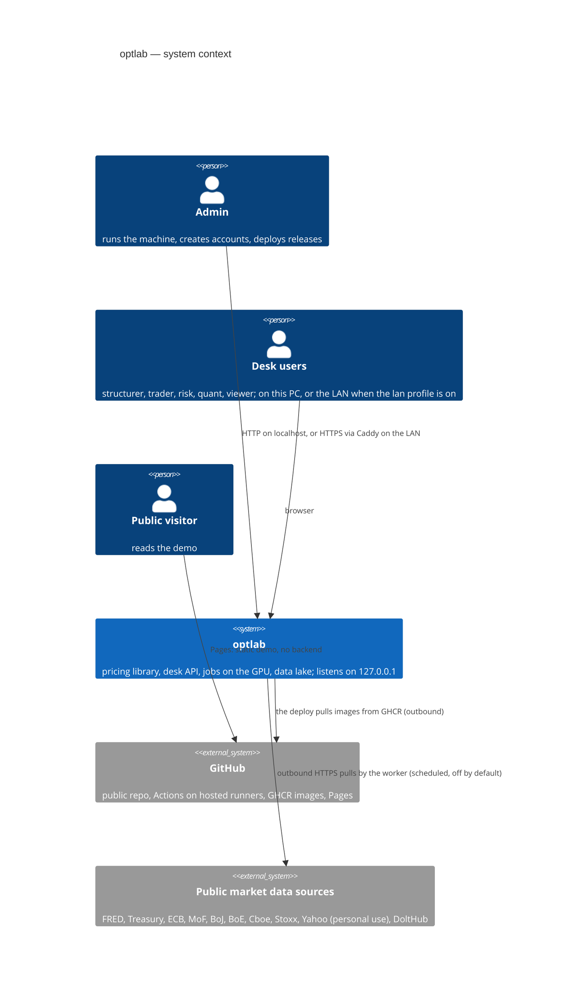
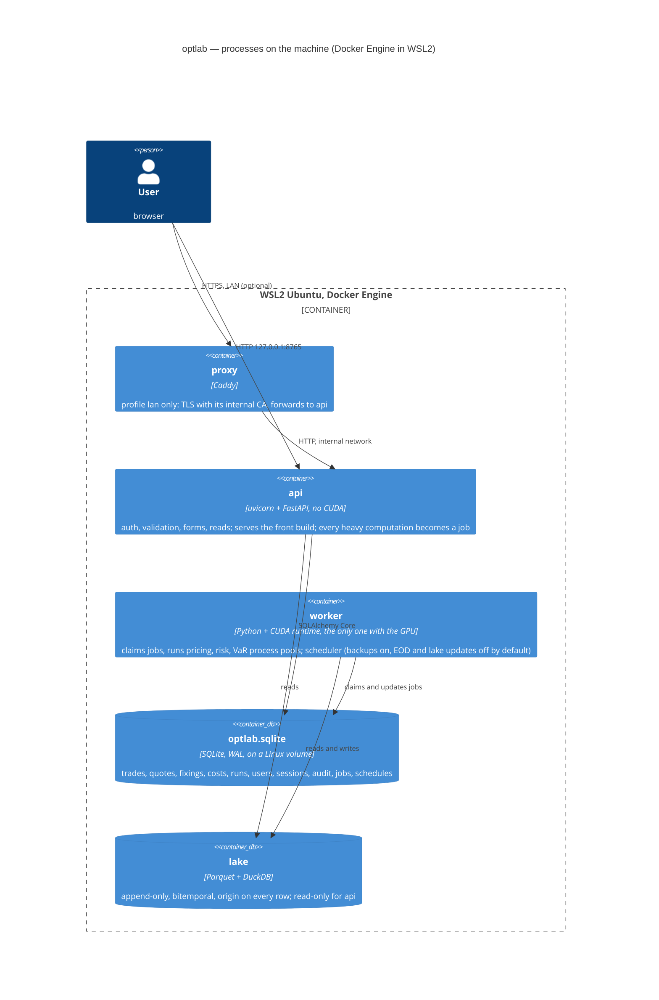
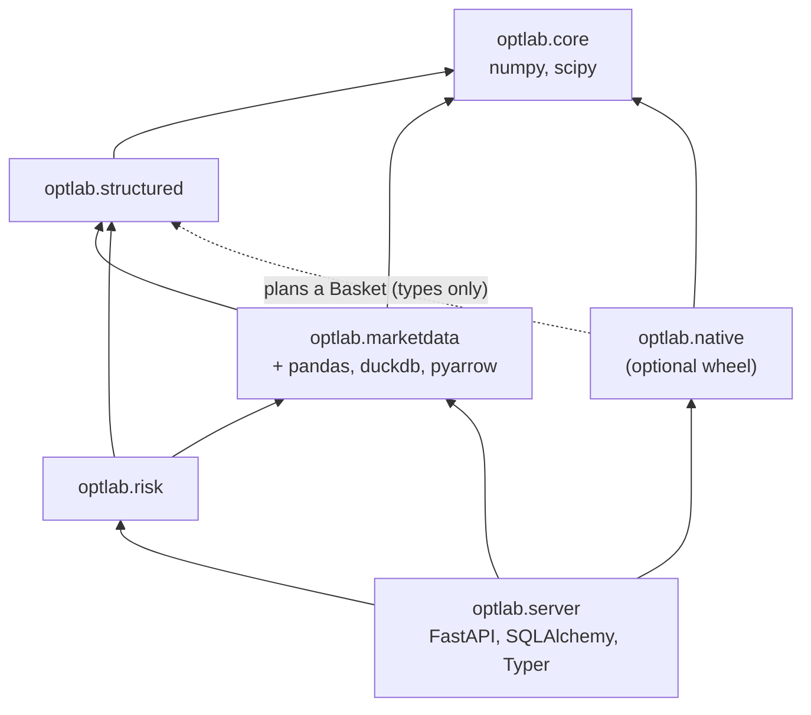

# Architecture

optlab is an equity derivatives library (closed forms, Heston, local vol, SLV, structured products, a risk engine, a
historical data lake, a GPU Monte Carlo engine) with a desk on top: an API, a job worker and a web front. It runs on
one workstation with an NVIDIA GPU, for a few named users, and **it is never reachable from the internet**. Its public
face is a static demo on GitHub Pages.

This page is the overview. The deep dives:

| Subject | Document |
|---|---|
| The library's internals (simulation, products, risk, market data) | [library.md](library.md) |
| The API's conventions | [api.md](api.md) |
| The front: principles, spaces, bridges, the public demo | [../ux.md](../ux.md) |
| Running the desk: start, accounts, backups, containers, releases | [operations.md](operations.md) |
| Security | [security.md](security.md) |
| The GPU engine | [../../packages/native/cuda/README.md](../../packages/native/cuda/README.md) |
| Every function and where it lives | [feature-inventory.md](feature-inventory.md) |
| Vocabulary | [glossary.md](glossary.md) |
| Decisions and their reasons | [adr/](adr/README.md) |

## 1. Context



Nothing calls into the machine from outside: no port forwarding, no tunnel, no webhook. Every connection the machine
makes is outbound (market data, image pulls).

## 2. Processes



- **api** never computes anything long: a quote, a valuation, a VaR or a fit is a row in the `jobs` table. It answers
  `202 {job_id}`, and the page follows `GET /api/v1/jobs/{id}/events` (Server-Sent Events).
- **worker** is the only process that sees the GPU. It claims jobs from the same SQLite file (an atomic
  `UPDATE ... RETURNING`), writes their progress, checks their cancel flag, and keeps the VaR's process pool, to which
  it passes the engine explicitly.
- **proxy** exists only in the `lan` profile, off by default ([operations.md](operations.md), "Open to the LAN").
- Ports are published on `127.0.0.1` only. The Docker daemon listens on its unix socket only, and no container mounts
  it.
- The same code runs without containers: `optlab serve` and `optlab worker` on Windows, for development.

## 3. Packages

A modular monolith: one repository, one `uv` workspace, six installable distributions sharing the PEP 420 namespace
`optlab` ([ADR-0003](adr/0003-modular-monolith-uv-workspace.md)).

```
packages/
  core/        optlab.core        models, Market, simulate, pricers, calibration, instrument registry, engine registry
  native/      optlab.native      nanobind bindings + the C++/CUDA engine, one wheel; optional
  structured/  optlab.structured  payoff script language, term-sheet schema, compiler, pricing policy, quote, costs, book
  marketdata/  optlab.marketdata  lake, sources, derived tables, point-in-time markets, replay, vol lab
  risk/        optlab.risk        Greeks, ladders, scenarios, VaR, explained P&L
  server/      optlab.server      FastAPI routers, accounts, jobs, worker, scheduler, persistence, settings, CLI
frontend/                         React + TypeScript + Vite; the api serves its build
api/openapi.json                  the versioned contract (drift checked in CI)
deploy/                           Dockerfiles, compose.yaml, Caddyfile, the WSL scripts
```

### Dependency direction



- Layers: `server > risk > marketdata > structured > core`, checked by `import-linter` in CI (imports inside functions
  count) ([ADR-0004](adr/0004-dependency-direction.md)).
- Only `server` imports `optlab.native`. The other packages ask `optlab.core.engines` for an engine by name; the
  registry finds the native one through the entry point group `optlab.engines`, and falls back to NumPy with the
  reason.
- `optlab.core` imports nothing but NumPy and SciPy, does no I/O and starts no thread at import
  (`test_core_alone.py`).

### No business rule outside the domain packages

`optlab.server` holds adapters: HTTP routers, request models, accounts, the job queue, persistence, settings and the
CLI. Its services orchestrate domain calls; a rule (what a valid term sheet is, how a VaR is computed, what a reserve
is) lives in a domain package with its tests. The front holds none either: term-sheet forms come from the server's
schema, and their validation too.

Domain packages that need storage (risk runs, vol lab and replay runs, the snapshot store) declare a small repository
protocol, which `optlab.server.persistence` implements on SQLAlchemy Core. The lake keeps its own access layer
(Parquet, DuckDB), with its paths from `Settings`.

## 4. Data and state

| State | Where | Who writes | Backup |
|---|---|---|---|
| Operational database (trades, quotes, fixings, costs, runs, users, sessions, audit, jobs, schedules) | `optlab.sqlite`, SQLite in WAL on a Linux volume, schema by Alembic | api (short writes), worker (jobs, runs) | nightly `VACUUM INTO`, 14 days |
| Market snapshots | in the database (content-addressed ids) | api, worker | with the database |
| Lake | `<data>/lake` (Parquet, DuckDB views) | worker (scheduled updates, off by default), CLI | weekly copy |
| Calibrations (`*_calibration.json`) | `<data>/archive/`, and a GitHub release asset | `optlab calib run` | release asset |
| Configuration | `<data>/config/optlab.env`, restricted rights | the admin | not in git |
| Logs | `<data>/logs`, JSON lines, rotated | api, worker | none |

The lake lives in a WSL volume for the containers ([ADR-0022](adr/0022-lake-in-a-wsl-volume.md)): reading it from
`/mnt/c` is several times slower. The database lives on a Linux volume in every case: WAL relies on shared memory that
the Windows file share does not provide reliably.

## 5. Invariants

Each one has a golden test (`tests/golden/`) or a named test:

- Prices depend on `(seed, n_paths)` only: not on the grid, the batch size, the number of workers or the process that
  runs them. Payoff scripts reproduce the hand-written pricers bit for bit.
- The library's default engine is NumPy; the desk starts in `auto`. A worker always receives its engine explicitly.
- A job freezes the market context when it is submitted: switching the market in use never changes a run in progress.
- Every Monte Carlo number carries its standard error and its method; every result names its snapshot and its
  `origin`.
- Point in time: `market_at` reads only rows dated at or before the date. The model stays at spot 100; real levels
  cross at the boundary through `spot_scale`. Pricing a sheet on another name's market is an error.
- The API speaks fractions, the screen percent.
- CUDA: no double literal in path code, Philox subsequence = pair index, `__expf`/`__logf` off, the GPU timed after a
  sustained warm-up.

## 6. How it is checked

- CI on GitHub's hosted runners, Linux and Windows: lint and types, the test suite without the GPU and the real data,
  the golden numbers, the CPU engine, the API contract, the front (lint, unit tests, build, end-to-end tests against
  the API, the public demo's tests), the security scans and the images ([ADR-0018](adr/0018-ci-hosted-runners.md)).
- On the machine: the whole suite (the real lake and the GPU included) and `tests/golden/golden.py check --local`.
- Every stochastic pricer is checked against an independent reference within four standard errors, with fixed seeds
  ([ADR-0017](adr/0017-tests-and-golden-numbers.md)).
