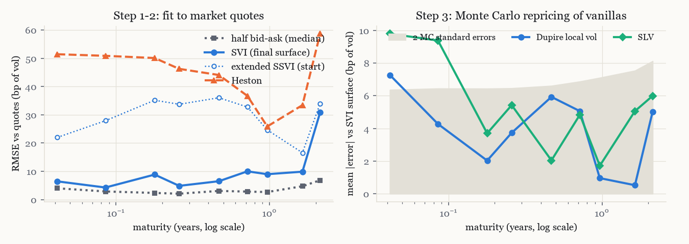
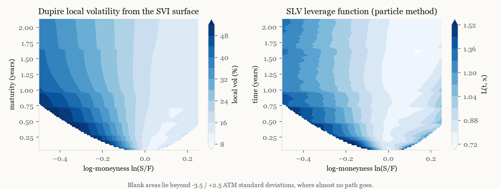
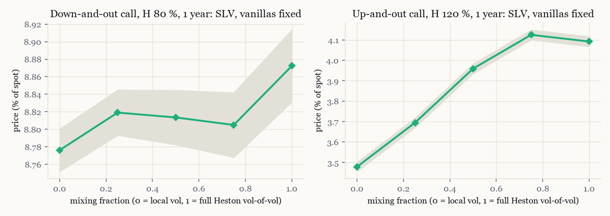
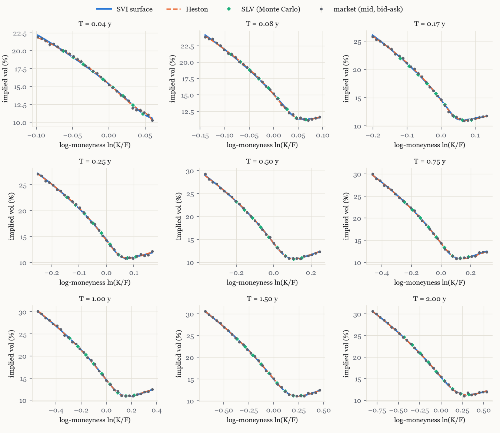
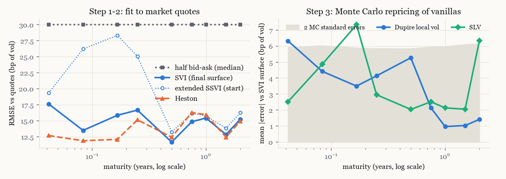
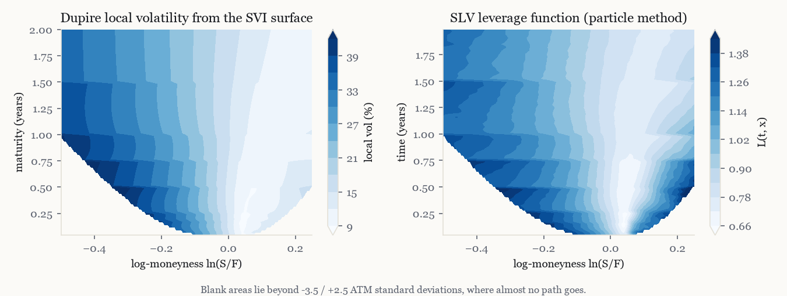
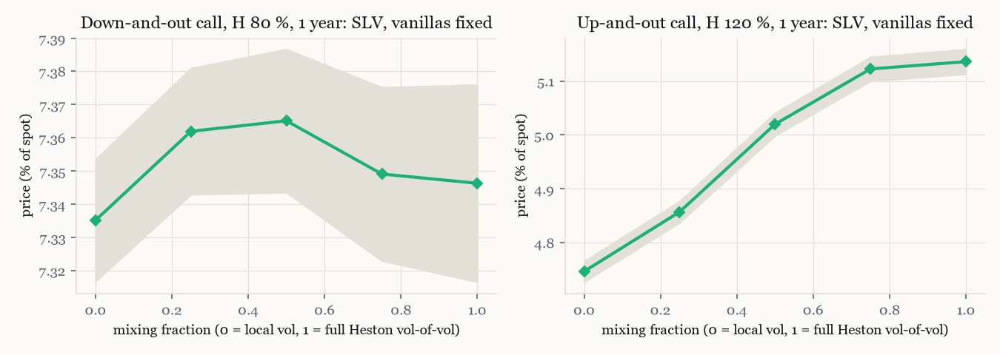

# Calibration report

Generated by `scripts/run_calibration.py` and `scripts/make_report.py`. Three steps: an implied surface (extended SSVI as an arbitrage-free start, then raw SVI slices under no-arbitrage constraints), Heston on the same vanillas, then the leverage function of the Heston SLV model by the particle method. Errors are in basis points of implied volatility (1 bp = 0.01 vol point).

## SPX, snapshot of 2026-10-27 (13:37 New York)

9 maturities from 0.04 to 2.14 years, 1694 out-of-the-money quotes after cleaning. Discounting: zero rate 4.62 % + 0.27 % x T, implied from put-call parity on 20 maturities beyond two months.

### Step 1: implied surface

Static-arbitrage checks on the fitted surface: minimum of Gatheral's g(k) = 0.047 (butterfly-free: True), minimum calendar increment of total variance = -6.7e-08 (calendar-free on k in [-1, 0.5]: True). Fit time 130 s.

### Step 2: Heston

| Parameter | Calibrated |
|---|---|
| v0 | 0.0228 |
| kappa | 3.0893 |
| theta | 0.0537 |
| xi (vol of vol) | 1.3077 |
| rho | -0.6880 |

Feller ratio 2 kappa theta / xi^2 = 0.19 (below 1: the variance can touch zero). Fit time 5 s.

### Step 3: SLV leverage

Mixing fraction 0.50 (the SLV variance has 50% of the Heston vol of vol), 200,000 particles, graded time grid. Calibration time 31 s.

### Errors per maturity (basis points of implied vol)

SVI, SSVI and Heston: RMSE against every quote. Local vol and SLV: mean absolute error of a Monte Carlo repricing (300,000 paths, 9 strikes from -2 to +1.5 ATM standard deviations) against the SVI surface they are built on; the last column is the Monte Carlo standard error.

| Expiry | T (y) | Quotes | Half bid-ask | SVI | SSVI (start) | Heston | Local vol | SLV | SLV max | MC s.e. |
|---|---|---|---|---|---|---|---|---|---|---|
| 2026-11-11 | 0.04 | 120 | 4.0 | 6.4 | 22 | 51 | 7.3 | 9.8 | 17.2 | 3.2 |
| 2026-11-27 | 0.09 | 133 | 2.9 | 4.3 | 28 | 51 | 4.3 | 9.4 | 14.6 | 3.2 |
| 2026-12-31 | 0.18 | 427 | 2.3 | 8.8 | 35 | 50 | 2.0 | 3.7 | 9.5 | 3.2 |
| 2027-01-29 | 0.26 | 255 | 2.1 | 4.9 | 34 | 46 | 3.7 | 5.4 | 10.4 | 3.2 |
| 2027-04-16 | 0.47 | 134 | 3.1 | 6.5 | 36 | 44 | 5.9 | 2.0 | 4.4 | 3.3 |
| 2027-07-16 | 0.72 | 160 | 2.8 | 10.0 | 33 | 37 | 5.1 | 4.8 | 10.2 | 3.4 |
| 2027-10-15 | 0.97 | 169 | 2.7 | 9.0 | 25 | 26 | 1.0 | 1.7 | 2.9 | 3.6 |
| 2028-06-16 | 1.64 | 183 | 4.7 | 9.9 | 17 | 33 | 0.5 | 5.1 | 13.1 | 3.8 |
| 2028-12-15 | 2.14 | 113 | 6.8 | 30.8 | 34 | 59 | 5.0 | 6.0 | 11.5 | 4.1 |

### Model risk: same vanillas, different exotics

Monte Carlo prices in % of spot, standard errors in brackets. Black-Scholes uses the 1-year ATM vol.

| Product (1 year, % of spot) | Black-Scholes (ATM vol) | Heston | Local vol (Dupire) | SLV (mix 0.50) |
|---|---|---|---|---|
| Down-and-out call, K 100 %, H 80 % | 8.625 (0.019) | 8.763 (0.019) | 8.793 (0.012) | 8.826 (0.015) |
| Up-and-out call, K 100 %, H 120 % | 1.870 (0.008) | 4.692 (0.013) | 3.489 (0.011) | 3.967 (0.012) |
| Down-and-in put, K 100 %, H 85 % | 3.647 (0.014) | 4.843 (0.025) | 4.715 (0.025) | 4.763 (0.025) |
| Asian call, 12 monthly fixings, K 100 % | 5.091 (0.000) | 5.050 (0.010) | 5.027 (0.006) | 5.041 (0.008) |
| American put, K 100 %, 50 dates | 5.114 (0.011) | 5.471 (0.031) | 5.370 (0.024) | 5.444 (0.028) |

Barrier prices when the leverage is recalibrated for each mixing fraction (0 = local vol, 1 = full Heston vol of vol): vanillas stay on the surface, barriers move.

| Mixing fraction | Down-and-out call, H 80 % | Up-and-out call, H 120 % | ATM vol error (bp) |
|---|---|---|---|
| 0.00 | 8.776 (0.012) | 3.478 (0.011) | +1.4 |
| 0.25 | 8.819 (0.013) | 3.694 (0.012) | +1.8 |
| 0.50 | 8.814 (0.016) | 3.959 (0.012) | +0.5 |
| 0.75 | 8.805 (0.018) | 4.125 (0.012) | +7.5 |
| 1.00 | 8.872 (0.021) | 4.092 (0.012) | +43.7 |

At a mixing fraction of 1.00 the leverage no longer reproduces the ATM vol (+44 bp): with the full calibrated vol of vol (xi = 1.31) the leverage needed where the variance is small hits its bounds. That point is not a valid SLV calibration.

## Simulated market

Quotes generated by a known Heston model on 9 maturities from two weeks to two years, with 15 bp of Gaussian noise on the implied vols. The calibration must find the parameters back.

### Step 1: implied surface

Static-arbitrage checks on the fitted surface: minimum of Gatheral's g(k) = 0.287 (butterfly-free: True), minimum calendar increment of total variance = 1.3e-04 (calendar-free on k in [-1, 0.5]: True). Fit time 22 s.

### Step 2: Heston

| Parameter | True | Calibrated |
|---|---|---|
| v0 | 0.0250 | 0.0250 |
| kappa | 1.8000 | 1.8010 |
| theta | 0.0400 | 0.0398 |
| xi (vol of vol) | 0.7500 | 0.7478 |
| rho | -0.7500 | -0.7513 |

Feller ratio 2 kappa theta / xi^2 = 0.26 (below 1: the variance can touch zero). Fit time 2 s.

### Step 3: SLV leverage

Mixing fraction 0.50 (the SLV variance has 50% of the Heston vol of vol), 200,000 particles, graded time grid. Calibration time 29 s.

### Errors per maturity (basis points of implied vol)

SVI, SSVI and Heston: RMSE against every quote. Local vol and SLV: mean absolute error of a Monte Carlo repricing (300,000 paths, 9 strikes from -2 to +1.5 ATM standard deviations) against the SVI surface they are built on; the last column is the Monte Carlo standard error.

| Expiry | T (y) | Quotes | Half bid-ask | SVI | SSVI (start) | Heston | Local vol | SLV | SLV max | MC s.e. |
|---|---|---|---|---|---|---|---|---|---|---|
| 0.042y | 0.04 | 30 | 30.0 | 17.6 | 19 | 13 | 6.3 | 2.5 | 5.9 | 3.0 |
| 0.083y | 0.08 | 31 | 30.0 | 13.5 | 26 | 12 | 4.4 | 4.9 | 7.7 | 3.0 |
| 0.167y | 0.17 | 31 | 30.0 | 15.9 | 28 | 12 | 3.5 | 7.3 | 14.4 | 2.9 |
| 0.250y | 0.25 | 31 | 30.0 | 16.7 | 25 | 15 | 4.1 | 3.0 | 6.6 | 2.9 |
| 0.500y | 0.50 | 31 | 30.0 | 11.7 | 13 | 12 | 5.3 | 2.0 | 5.7 | 2.9 |
| 0.750y | 0.75 | 31 | 30.0 | 14.9 | 16 | 16 | 2.1 | 2.5 | 4.8 | 3.0 |
| 1.000y | 1.00 | 31 | 30.0 | 15.4 | 16 | 16 | 1.0 | 2.1 | 4.5 | 3.0 |
| 1.500y | 1.50 | 31 | 30.0 | 12.9 | 14 | 12 | 1.0 | 2.1 | 5.2 | 3.1 |
| 2.000y | 2.00 | 31 | 30.0 | 15.2 | 16 | 15 | 1.4 | 6.3 | 11.9 | 3.1 |

### Model risk: same vanillas, different exotics

Monte Carlo prices in % of spot, standard errors in brackets. Black-Scholes uses the 1-year ATM vol.

| Product (1 year, % of spot) | Black-Scholes (ATM vol) | Heston | Local vol (Dupire) | SLV (mix 0.50) |
|---|---|---|---|---|
| Down-and-out call, K 100 %, H 80 % | 7.144 (0.016) | 7.309 (0.014) | 7.345 (0.009) | 7.375 (0.011) |
| Up-and-out call, K 100 %, H 120 % | 2.262 (0.008) | 5.253 (0.012) | 4.776 (0.010) | 5.035 (0.011) |
| Down-and-in put, K 100 %, H 85 % | 3.071 (0.013) | 4.380 (0.022) | 4.345 (0.022) | 4.380 (0.022) |
| Asian call, 12 monthly fixings, K 100 % | 4.244 (0.000) | 4.411 (0.008) | 4.390 (0.005) | 4.411 (0.006) |
| American put, K 100 %, 50 dates | 4.672 (0.011) | 4.981 (0.026) | 4.952 (0.022) | 4.994 (0.024) |

Barrier prices when the leverage is recalibrated for each mixing fraction (0 = local vol, 1 = full Heston vol of vol): vanillas stay on the surface, barriers move.

| Mixing fraction | Down-and-out call, H 80 % | Up-and-out call, H 120 % | ATM vol error (bp) |
|---|---|---|---|
| 0.00 | 7.335 (0.009) | 4.747 (0.010) | +1.7 |
| 0.25 | 7.362 (0.010) | 4.857 (0.010) | +2.7 |
| 0.50 | 7.365 (0.011) | 5.020 (0.011) | +2.6 |
| 0.75 | 7.349 (0.013) | 5.122 (0.011) | +1.9 |
| 1.00 | 7.346 (0.015) | 5.136 (0.012) | +9.0 |

